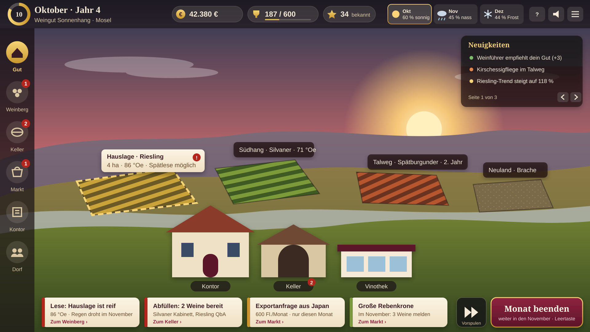
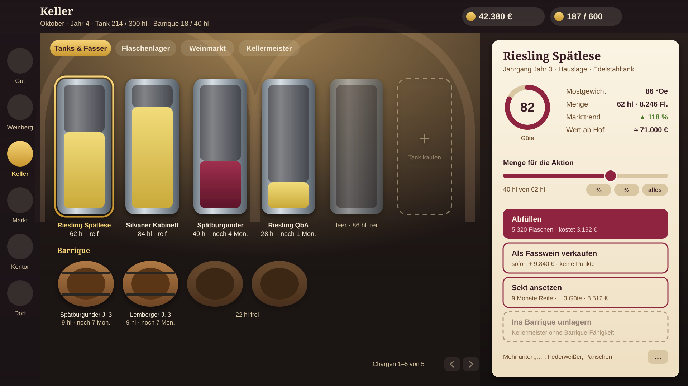

# Konzept: WinzerAI auf .NET 11 mit DrawnUi

Stand: 11.11.2026 (Konzept und Umsetzungsstand, Abschnitt 10) · Quelle: [Tee.WinzerAI](https://github.com/teebeast/Tee.WinzerAI) (Svelte 5, TypeScript, Tauri, Version 0.2.0)

Dieses Dokument beschreibt, wie das Spiel nach .NET 11 umzieht, wie die neue Oberfläche ohne Scrollen aussieht und wie das Spielkonzept spannender wird. Es enthält die Ergebnisse einer Machbarkeitsprüfung auf dem Entwicklungsrechner (Windows 11 ARM64, .NET SDK 11.0.100).

## 1. Kurzfassung

- **Engine 1:1 nach C# portieren und gegen das Original absichern.** Die Spiellogik (rund 5.700 Zeilen in `src/engine/`) ist frei von UI-Abhängigkeiten und Seed-basiert. Das erlaubt einen Vergleichstest: Das alte Spiel schreibt KI-Partien als Protokoll, die C#-Engine muss sie Zug für Zug nachspielen.
- **Eine gezeichnete Oberfläche, zwei Köpfe.** Die UI entsteht einmal in C# mit DrawnUi-Steuerelementen und läuft als WPF-Fenster (Desktop) und als Blazor-WebAssembly-App (Browser, PWA).
- **Der WPF-Kopf läuft heute unter .NET 11, der Browser-Kopf noch nicht.** SkiaSharp liefert für das Emscripten von .NET 11 erst Vorabpakete, die nicht zu DrawnUi 1.10.8.25 passen (Abschnitt 3). Reihenfolge deshalb: Desktop zuerst, Browser sobald die Pakete nachziehen.
- **Das Gut wird zur Bühne.** Statt sechs langer Seiten gibt es eine bildschirmfüllende Gutsansicht und fünf Szenen. Jede Ansicht passt auf einen Bildschirm; Listen werden geblättert, Details stehen in einem festen Inspektor.
- **Spielkonzept:** Die größten Schwächen sind ereignisarme Monate, Geld ohne Verwendung im Spätspiel und ein einziger Siegpfad. Dagegen stehen fünf Pflichtänderungen (Preise selbst setzen, Jahresziele, Ambitionen, Gutsausbau, Prämierung als Live-Ereignis) und fünf größere Erweiterungen für danach.

Entwürfe der neuen Oberfläche:





## 2. Ausgangslage

| Bereich | Heute | Umfang |
|---|---|---|
| Spiellogik | TypeScript, `applyAction(state, action)` als reine Funktion, Zufall per mulberry32 im Spielstand | 31 Dateien, ca. 5.700 Zeilen |
| Tests | Vitest: 17 Engine-Testdateien, Render- und Klicktests | |
| Oberfläche | Svelte 5, sechs Reiter (Hof, Weinberg, Keller, Aufträge, Betrieb, Rangliste), SVG-Grafiken, Web Audio | 27 Dateien, ca. 4.700 Zeilen |
| Hülle | PWA (Vite) und Tauri-Desktop-App, Spielstände als JSON | |
| Balancing | `npm run sim`: KI-Profile in allen 13 Gebieten über 15 Jahre | |

Was bleibt: Regeln, Zahlenwerte, KI-Profile, Texte, Lexikon, Spielstandformat als Vorlage. Was entfällt: Svelte, Vite, Tauri, Rust, Node als Laufzeitabhängigkeit.

Die heutige Oberfläche scrollt auf jeder Seite: Der Hof zeigt Panorama, vier Kennzahlen, Aufgaben, Versteigerung, Wetter, Neuigkeiten und Logbuch untereinander; Weinberg und Keller sind Kartenlisten ohne feste Höhe.

## 3. Machbarkeitsprüfung

Geprüft mit einem Wegwerfprojekt (gemeinsame UI-Bibliothek, WPF-Kopf, Blazor-WASM-Kopf), DrawnUi 1.10.8.25.

| Frage | Ergebnis |
|---|---|
| Baut und zeichnet `DrawnUi.Wpf` unter `net11.0-windows` auf ARM64? | Ja. Das Paket zielt auf net9/net10, wird unter .NET 11 ohne Warnung aufgelöst und zeichnet Text und Formen korrekt. ANGLE liegt für win-arm64, win-x64 und win-x86 bei. |
| Lässt sich UI-Code zwischen WPF und Blazor teilen? | Ja, aber nur per Multi-Targeting. Jeder Kopf bringt die Engine in einer eigenen Assembly mit (`DrawnUi.Wpf.dll`, `DrawnUi.Blazor.dll`), beide mit Namensraum `DrawnUi.Draw`. Eine Bibliothek mit zwei Zielframeworks und bedingten Paketverweisen übersetzt denselben Quelltext für beide. |
| Baut `DrawnUi.Blazor.Wasm` unter `net11.0`? | Nein. SkiaSharp 4.148 enthält native Bibliotheken nur für Emscripten 3.1.34 und 3.1.56, .NET 11 linkt mit 6.0.2 (`undefined symbol: saveSetjmp`). |
| Hilft die SkiaSharp-Vorabversion 4.158? | Nein. Sie enthält Bibliotheken für 6.0.2 und linkt, aber DrawnUi prüft zur Laufzeit auf Version 148 und bricht ab. Hebt man alle SkiaSharp-Pakete an, fehlen HarfBuzz-Symbole beim Linken. |
| Läuft der Browser-Kopf vorerst unter `net10.0`? | Offen. Das Projekt baut mit dem SDK 11, linkt SkiaSharp aber nur mit installierter Workload `wasm-tools-net10`. Die Workload habe ich nicht installiert, deshalb ist dieser Weg ungeprüft. |

Folgerungen:

1. Engine, Präsentationsschicht und Tests zielen auf `net11.0`, der Desktop auf `net11.0-windows`.
2. Die UI-Bibliothek zielt auf `net11.0-windows` und ein Browser-Framework, das in einer MSBuild-Eigenschaft steht (`WebTfm`). Heute wäre das `net10.0`, später `net11.0`.
3. Der Browser-Kopf kommt in Phase 6. Bis dahin entscheidet sich, ob DrawnUi auf SkiaSharp 4.158 wechselt oder ob `net10.0` mit Workload trägt.

## 4. Architektur

### 4.1 Projektmappe

```
Tee.Winzer.Net/
├─ src/
│  ├─ Winzer.Engine/          net11.0            Regeln, Daten, KI – keine Abhängigkeiten
│  ├─ Winzer.Presentation/    net11.0            Ansichtsmodelle, Navigation, Texte, Dienste-Schnittstellen
│  ├─ Winzer.Ui/              net11.0-windows;$(WebTfm)   DrawnUi-Szenen und Steuerelemente (nur C#)
│  ├─ Winzer.Desktop/         net11.0-windows    WPF-Fenster, Dateien, Ton
│  └─ Winzer.Web/             $(WebTfm)          Blazor WebAssembly, PWA
├─ tests/
│  ├─ Winzer.Engine.Tests/    Regeltests + Vergleichstests gegen das Original
│  └─ Winzer.Presentation.Tests/
├─ tools/
│  └─ Winzer.Sim/             Balancing-Report als Konsolenprogramm
├─ assets/                    Schriften, Illustrationen, Shader, Lottie
├─ docs/
├─ Directory.Build.props      Sprachversion, Nullable, Warnungen als Fehler, WebTfm
└─ Directory.Packages.props   zentrale Paketversionen
```

Abhängigkeiten laufen nur in eine Richtung: Köpfe → Ui → Presentation → Engine. DrawnUi kommt ausschließlich in `Winzer.Ui` und den Köpfen vor. Damit bleibt der Schaden begrenzt, falls die Bibliothek ersetzt werden muss.

### 4.2 Engine

- **Zustand:** veränderliche Klassen mit generiertem tiefen Kopieren. `Game.Apply(state, action)` kopiert wie heute zuerst den Zustand und ändert dann die Kopie – von außen bleibt es eine reine Funktion. Unveränderliche Records mit `with` würden jede der rund 40 Aktionen umschreiben und den Vergleich mit dem Original erschweren; das kann später folgen.
- **Aktionen:** `abstract record GameAction` mit einem Record je Aktion (`Plant`, `Harvest`, `Bottle` …), serialisiert über `System.Text.Json` mit Quellgenerator und Typ-Diskriminator. Das ist trimm- und AOT-tauglich, was der Browser-Kopf braucht.
- **Zufall:** mulberry32 bitgleich mit `uint`-Arithmetik in `unchecked`. `Math.imul` entspricht der 32-Bit-Multiplikation in C#.
- **Zahlen:** überall `double`, wie in JavaScript. Rundungen stehen an denselben Stellen wie im Original.
- **Reihenfolgen:** Wo das Original über Objektschlüssel iteriert (`trends`, `relations`, `limits`), nutzt C# Sammlungen mit fester Reihenfolge, sonst weichen die Zufallszüge ab.
- **Dateistruktur:** eine C#-Datei je TypeScript-Datei mit gleichem Namen (`vineyard.ts` → `Vineyard.cs`). Das macht den Abgleich beim Portieren und bei späteren Regeländerungen einfach.
- **Regelversion:** `GameState.RulesVersion`. Version 1 ist das portierte Original, Version 2 enthält die Änderungen aus Abschnitt 6. Tages-Challenges und Vergleichstests bleiben so reproduzierbar.

### 4.3 Vergleichstest gegen das Original

Das ist die wichtigste Absicherung der Portierung.

1. Im alten Repository entsteht ein Skript `scripts/trace.ts`. Es lässt für eine Liste von Startwerten (Gebiet, KI-Profile, Seed, Optionen) reine KI-Partien laufen und schreibt je Partie die Aktionen und nach jedem Monat einen Auszug des Zustands (Konto, Punkte, Bekanntheit, Bestände, RNG-Zustand) als JSON.
2. `Winzer.Engine.Tests` liest diese Dateien, spielt dieselben Aktionen ab und vergleicht nach jedem Monat. Ganzzahlen und der RNG-Zustand müssen exakt stimmen, Gleitkommawerte auf 1e-9 relativ.
3. Zusätzlich lässt der Test die C#-KI selbst spielen und vergleicht die gewählten Aktionen. So ist auch `ai.ts` abgedeckt.

Risiko: `Math.pow`, `Math.exp` und ähnliche Funktionen können sich zwischen V8 und .NET im letzten Bit unterscheiden. Solche Abweichungen fallen in der Toleranz nicht auf, können aber an Schwellen (zum Beispiel „≥ 80 °Oe“) Entscheidungen kippen. Der Test meldet den ersten abweichenden Monat mit Feld; betroffene Stellen werden einzeln angeglichen.

Die 17 Engine-Testdateien werden zusätzlich nach xUnit übertragen. Sie dokumentieren Regeln, die in KI-Partien selten vorkommen (Sabotage, Panschen, Versteigerung mit Menschen).

### 4.4 Präsentationsschicht

`Winzer.Presentation` enthält alles, was die Oberfläche wissen muss, aber nichts, was zeichnet:

- `GameSession`: hält den Zustand, führt Aktionen aus, lässt KI-Züge und Vorspulen laufen, speichert nach jedem Zug, meldet Änderungen.
- Ansichtsmodelle je Szene (`EstateView`, `VineyardView`, `CellarView` …). Sie liefern fertige Texte, Seiten für geblätterte Listen und die Vorschau jeder Aktion („5.320 Flaschen · kostet 3.192 €“) über `Game.Validate`.
- `Navigator`: aktuelle Szene, Reiter, Auswahl, offene Dialoge. Sprünge aus Aufgabenkarten laufen hierüber.
- Schnittstellen für die Köpfe: `ISaveStore` (Spielstände), `IAudio` (Klänge), `IClock` (Datum für die Tages-Challenge), `ISettings`.

Diese Schicht ist ohne Fenster testbar. Die heutigen Klicktests (jsdom) werden zu Tests gegen die Ansichtsmodelle.

### 4.5 Oberfläche mit DrawnUi

Die Szenen sind C#-Klassen, die einen Baum aus `SkiaLayout`, `SkiaShape`, `SkiaLabel`, `SkiaButton` und eigenen Steuerelementen bauen. XAML entfällt, weil es nur im WPF-Kopf verfügbar wäre.

```csharp
// Winzer.Ui – wird für beide Köpfe übersetzt
public static class Screens
{
    public static SkiaControl Estate(EstateView view) => new SkiaLayout
    {
        Type = LayoutType.Column,
        Children = { new HudBar(view.Hud), new EstateStage(view), new TaskCards(view.Tasks) },
    };
}

// Winzer.Desktop – MainWindow
Root.Children.Add(new DrawnUiElement { Content = Screens.Estate(session.Estate) });
```

```razor
@* Winzer.Web – Home.razor *@
<Canvas Content="@root" />
```

Festlegungen:

- **Feste Entwurfsfläche 1920 × 1080**, die als Ganzes auf das Fenster skaliert wird (DrawnUi bringt dafür `RescalingCanvas` im Spiele-Zusatzpaket mit). Bei abweichendem Seitenverhältnis füllt die Bühne den Rand, Kopfzeile und Leisten bleiben an den Kanten. Mindestgröße 1280 × 720.
- **Beschleunigtes Zeichnen** im WPF-Kopf (`RenderingMode = Accelerated`). Bilder entstehen nur, wenn sich etwas ändert oder eine Animation läuft.
- **Eigene Steuerelemente:** `HudBar`, `NavRail`, `TaskCard`, `Inspector`, `PagedGrid` (blättert statt zu scrollen), `AmountSlider`, `GaugeRing`, `Tank`, `Barrel`, `BottleLabel`, `PlotPatch`, `WeatherChip`, `DecisionDialog`.
- **Keine Texteingabe für Mengen.** Schieber, Schnellwahl (¼, ½, alles) und Plus/Minus ersetzen Zahlenfelder. Text wird nur für Spieler- und Gutsnamen gebraucht (`SkiaEditor`).
- **Bedienhilfen:** DrawnUi stellt die Steuerelemente für Bildschirmleser bereit (UI Automation unter Windows, ARIA-Ebene im Browser). Dazu Tastenkürzel und eine Einstellung „Bewegung reduzieren“.

### 4.6 Köpfe

| | Desktop (`Winzer.Desktop`) | Browser (`Winzer.Web`) |
|---|---|---|
| Spielstände | JSON-Dateien unter `%LOCALAPPDATA%\WinzerAI\Spielstände` wie bisher | IndexedDB über JS-Interop |
| Ton | Synthese nach PCM, Ausgabe über einen kleinen Mixer | Web Audio über JS-Interop |
| Verteilung | Self-contained für win-x64 und win-arm64 mit Installer | Statische Dateien, PWA, GitHub Pages |
| Start | sofort | Ladezeit durch WebAssembly; AOT-Übersetzung für flüssiges Spiel nötig |

Alte Spielstände (Version 17) liest ein Importer in `Winzer.Engine`, weil das JSON-Format erhalten bleibt. Ältere Versionen werden nicht migriert.

### 4.7 Build und Veröffentlichung

- **CI** bei jedem Push: `dotnet build`, `dotnet test`, Formatprüfung. Läufer `windows-latest` wegen WPF.
- **Release** bei Versions-Tag: Desktop für x64 und ARM64, später der Browser-Stand als ZIP und auf Pages.
- **Lizenzhinweise** der NuGet-Pakete und Schriften als generierte Datei wie heute.
- Die Version steht einmal in `Directory.Build.props`.

## 5. Oberfläche und Bedienung

### 5.1 Leitlinien

1. **Alles auf einem Bildschirm.** Keine Ansicht scrollt. Was nicht passt, wird geblättert, in Reiter geteilt oder erst bei Auswahl gezeigt.
2. **Das Gut ist die Navigation.** Parzellen und Gebäude in der Gutsansicht sind anklickbar und führen in die passende Szene. Die Leiste links bietet dieselben Ziele für Tastatur und schnelle Wechsel.
3. **Auswählen, dann handeln.** Links oder in der Mitte stehen Dinge (Parzellen, Tanks, Flaschenposten), rechts der Inspektor mit Werten und Aktionen des gewählten Dings. Jede Aktion zeigt vor dem Klick, was sie bewirkt und kostet.
4. **Dringendes kommt zum Spieler.** Aufgabenkarten unten in der Gutsansicht, Zähler an Leiste und Gebäuden, Entscheidungen als Dialog in der Bildmitte.
5. **Der Monatswechsel ist ein Moment.** Ein kurzer Übergang zeigt Wetter, Reife und Ereignisse, bevor der neue Monat beginnt.

### 5.2 Aufbau des Bildschirms

| Bereich | Größe (von 1920 × 1080) | Inhalt |
|---|---|---|
| Kopfzeile | volle Breite × 92 | Jahresrad mit Monat, Gutsname und Gebiet, Konto, Punkte mit Fortschritt, Bekanntheit, Wetter für drei Monate, Lexikon, Ton, Menü |
| Leiste links | 112 × 988 | Gut, Weinberg, Keller, Markt, Kontor, Dorf – mit Zählern für offene Aufgaben |
| Bühne | 1808 × 988 | Szene |
| Inspektor | 524 breit, rechts in der Bühne | Details und Aktionen zur Auswahl; in der Gutsansicht stattdessen Neuigkeiten |
| Aktionsleiste | unten in der Gutsansicht | bis zu vier Aufgabenkarten, Vorspulen, Monat beenden |

### 5.3 Szenen

| Szene | Ersetzt heute | Inhalt und Reiter |
|---|---|---|
| **Gut** | Hof | Panorama mit Parzellen und Gebäuden, Jahreszeit und Wetter; Aufgabenkarten; Neuigkeiten (geblättert); Monat beenden |
| **Weinberg** | Weinberg | Hang mit allen Parzellen als Flächen. Inspektor: Sorte, Alter, Reifeverlauf, Gesundheit, Lesearten mit Vorschau. Reiter: Parzellen · Pflanzenschutz und Bio · Wetterschutz |
| **Keller** | Keller | Gewölbe mit Tanks und Fässern. Reiter: Tanks und Fässer · Flaschenlager (Regal, 12 Posten je Seite) · Weinmarkt (Trends) · Kellermeister |
| **Markt** | Aufträge, Teile von Keller und Betrieb | Reiter: Aufträge und Export · Großhandel · Marketing · Prämierungen |
| **Kontor** | Betrieb | Reiter: Finanzen (Kredit, Jahresabschluss als Diagramm) · Ausbau (Gebäude, Shop, Vinothek) · Chronik (Logbuch als Zeitleiste, monatsweise geblättert) · Erfolge |
| **Dorf** | Rangliste | Dorfplatz mit den Weingütern der Mitspieler: Rangliste, Verhältnis der Nachbarn, Intrigen |

Vollbild-Ereignisse über der Szene: Weinbergversteigerung, Prämierung (neu, Abschnitt 6), Jahresrückblick (neu), Spielerwechsel im Hot-Seat (verdeckt wie heute den Bildschirm), Übersicht nach dem Vorspulen, Spielende.

Hauptmenü: Neues Spiel als Folge von drei Schritten (Spielart → Gebiet auf einer Deutschlandkarte → Gegner und Optionen) statt eines langen Formulars; Spielstände als Kartenraster.

### 5.4 Wo heute gescrollt wird und was es ersetzt

| Heute | Neu |
|---|---|
| Hof: sieben Blöcke untereinander | Gutsansicht mit festen Bereichen; Logbuch wandert ins Kontor |
| Parzellenkarten untereinander | Flächen im Hang; bei mehr als acht Parzellen ein zweiter Hang zum Blättern |
| Chargenliste im Keller | Tanks nebeneinander (sechs je Seite), Details im Inspektor |
| Flaschenposten als Liste | Regal mit zwölf Fächern je Seite, Filter nach Sorte und Status |
| Betrieb: Finanzen, Ausbau, Personal untereinander | Reiter im Kontor |
| Logbuch (bis 400 Einträge) | Zeitleiste, ein Monat je Seite, Sprung zu Jahren |
| Lexikon als lange Liste | Registerkarten A–Z, Suche, ein Begriff je Karte |
| Entscheidungen als Balken unter den Reitern | Dialog mit Illustration, Folgen je Wahl, Frist sichtbar |
| Neues Spiel als ein Formular | drei Schritte |

### 5.5 Gestaltung

- **Farben:** Weinrot, Rebgrün, Pergament und Gold auf dunklem Grund. Der Keller ist dunkel und warm beleuchtet, das Kontor hell wie Papier, der Weinberg folgt der Jahreszeit.
- **Schrift:** eine Serifenschrift für Überschriften und Zahlen, eine serifenlose für Fließtext. Beide mit freier Lizenz (SIL OFL), im Paket enthalten.
- **Panorama in Ebenen:** Himmel, ferne Hügel, Fluss, Hang, Gebäude. Die Ebenen verschieben sich leicht gegeneinander. Jahreszeit färbt Laub und Licht, Ausbauten (Vinothek, Barriquekeller, spätere Gebäude) erscheinen sichtbar auf dem Gut.
- **Wetter als Shader:** Regen, Nebel, Hitzeflimmern, Raureif und Schnee als SkSL-Effekte über der Bühne. DrawnUi unterstützt Shader auf jedem Steuerelement.
- **Bewegung mit Bedeutung:** Tanks füllen sich beim Keltern, Zahlen zählen hoch, Medaillen fallen mit Konfetti, die Reifeanzeige wächst beim Monatswechsel. Alles abschaltbar.
- **Etiketten:** Jeder Wein bekommt ein erzeugtes Flaschenetikett aus Gutsname, Sorte, Stufe und Jahrgang; Medaillen kleben sichtbar darauf.
- **Klang:** die bisherigen synthetischen Klänge, dazu leise Umgebung je Szene (Vögel, Kellerhall).

### 5.6 Tastatur

`1`–`6` Szenen · `Tab` nächste Auswahl · `Bild auf/ab` blättern · `Leertaste` Monat beenden · `F` vorspulen · `L` Lexikon · `Esc` zurück.

### 5.7 Was wegfällt

Die heutige Oberfläche passt sich bis zur Handybreite an. Die neue ist für Querformat ab 1280 × 720 entworfen. Ein Hochformat für Handys bräuchte eigene Szenenlayouts und ist nicht Teil dieses Konzepts.

## 6. Spielkonzept

### 6.1 Befund

| Schwäche | Beleg | Folge |
|---|---|---|
| Viele Monate ohne Entscheidung | Designprinzip „eine Entscheidung pro Monat“, Vorspulen als Hauptwerkzeug; eine Partie hat 100–150 Monate | Der Spieler klickt sich durch, statt zu spielen |
| Geld ohne Verwendung im Spätspiel | Balancing-Stand M5: 1–12 Mio. € nach 15 Jahren, „Vermögen dient nur der Rangliste“ | Ab Jahr 7 fehlt die Knappheit, die das Spiel trägt |
| Ein einziger Siegpfad | Sieg nur über Punkte; starke Profile spielen sehr ähnlich | Wenig Wiederspielwert |
| Preise sind eine Formel | Flaschenpreis = Stufe × Güte × Bekanntheit | Die wichtigste Entscheidung eines Betriebs fehlt |
| Höhepunkte verpuffen | Prämierungen und Lese werden als Logzeile aufgelöst | Erfolge fühlen sich nicht wie Erfolge an |
| Gegner bleiben blass | Verhältniswert und Meldungen, kaum direkte Begegnung | Die Rangliste ist der einzige Bezug zu ihnen |
| Weine sind Datensätze | Stufe, Güte, Menge | Keine Bindung an einen großen Jahrgang |

### 6.2 Pflichtpaket (Regelversion 2, mit der ersten .NET-Version)

Kleine Eingriffe mit großer Wirkung. Jede Änderung braucht eine KI-Regel, sonst verfälscht sie das Balancing.

1. **Preise selbst setzen.** Je Flaschenposten oder Preisklasse ein Aufschlag von −20 % bis +40 % auf den Richtpreis. Die Ab-Hof-Nachfrage reagiert darauf, abhängig von Bekanntheit, Medaillen und Markttrend. Teure Weine verkaufen sich langsam, binden Lager und können zum Ruf beitragen; billige räumen den Keller. Aufwand klein: Die Nachfrageformel in `market.ts` bekommt einen Faktor.
2. **Jahresziele und Jahresrückblick.** Im Januar wählt jeder eines von drei Zielen („zwei Medaillen“, „Schulden unter 50.000 €“, „8.000 Flaschen ab Hof“). Im Dezember zeigt ein Rückblick Jahrgangsnote, Bilanz, Rangfolge und das Ergebnis des Ziels. Das gibt jedem Jahr einen Bogen und ersetzt die nackte Bilanz.
3. **Ambitionen statt nur Punkte.** Zu Spielbeginn wählt jeder zwei von sechs Ambitionen, die am Ende zusätzlich zählen: Rieslingkönig (Gold mit einer Sorte), Großgrundbesitzer (Fläche), Bio-Vorreiter (Lunaris), Exportmeister, Sektbaron, Saubermann (nie gepanscht oder sabotiert). Gegner sehen die Ambitionen nicht. Die KI-Profile haben feste Ambitionen, die zu ihrem Stil passen.
4. **Gutsausbau als Geldsenke.** Neue Gebäude mit eigener Wirkung und sichtbarem Platz im Panorama: Gästehaus (Einnahmen in der Saison, Bekanntheit), Gutsschänke (dauerhafte Straußwirtschaft), Sektmanufaktur (größere Mengen, bessere Güte), Schatzkammer (Abschnitt 6.3), Brennerei (Tresterbrand aus Lesemengen). Preise von 100.000 € bis 800.000 €. Dazu eine **Stiftung**: Geld gegen Punkte mit steigendem Preis je Punkt, damit Vermögen im Endspiel zählt.
5. **Prämierung als Live-Ereignis.** Wie die Versteigerung ein eigener Bildschirm: Die Juroren decken ihre Noten einzeln auf, die Weine der Gegner stehen daneben, Medaillen werden verliehen. Die Rechnung (Güte + Stufenbonus ± 5) bleibt; der Zufallsanteil wird auf drei Juroren verteilt. Aufwand klein, weil nur die Darstellung neu ist.

### 6.3 Erweiterungen danach

| Idee | Kern | Wirkung | Aufwand |
|---|---|---|---|
| **Lesewochen** | September bis November laufen in je zwei Halbmonaten, Januar und Februar werden zu einem Zug. Das Jahr hat dann 14 statt 12 Züge, aber die Lese bekommt sechs. Jede Halbmonatsvorhersage wird als Karte aufgedeckt. | Der Höhepunkt des Jahres wird zum Nervenspiel, der Winter kürzer | groß – Reife, Fäulnis und Kosten müssen neu abgestimmt werden |
| **Ausbaustil und Cuvée** | Beim Keltern Stil wählen (trocken, feinherb, lieblich); zwei Chargen zu einer Cuvée verschneiden. Kunden, Exportländer und Juroren haben Vorlieben. | Der Keller bekommt eigene Entscheidungen; Aufträge werden zum Puzzle | mittel |
| **Schatzkammer** | Flaschen großer Jahrgänge einlagern. Sie gewinnen jährlich an Wert und Güte, können auf einer Raritätenversteigerung verkauft oder für spätere Prämierungen aufgehoben werden. | Bindung an Weine, Geldanlage, späte Punkte | mittel |
| **Gegner mit Gesicht** | Jeder Computergegner bekommt Namen, Porträt, Sprüche und eine Ambition. Neu: Weinwette (zwei Güter setzen Geld oder Bekanntheit auf den besseren Wein bei der nächsten Prämierung), Abwerben des Kellermeisters, gemeinsame Genossenschaftsabfüllung. | Rivalität wird persönlich | mittel |
| **Dynastie und Geisterpartie** | Abgeschlossene Partien stehen in einer Familienchronik und schalten Erbstücke frei (kleiner Startbonus nach Wahl). In der Tages-Challenge läuft die eigene beste Partie als Geist in der Rangliste mit – möglich, weil Partien aus Seed und Aktionen reproduzierbar sind. | Wiederspielwert, Ansporn | mittel |

Weitere Kandidaten ohne Ausarbeitung: Wetterdienst als Investition (genauere Vorhersage), Lagenklassifikation (eine Parzelle steigt durch Medaillen im Rang), asynchroner Online-Mehrspieler über synchronisierte Aktionen.

### 6.4 Vorgehen beim Balancing

- Regelversion 1 bleibt als Referenz bestehen. Jede Änderung wird einzeln eingeschaltet und im Report (`Winzer.Sim`) gegen Version 1 verglichen: Punkte nach 5, 10 und 15 Jahren, Pleitequote, Vermögen.
- Zielwerte für Version 2: „Normal“ (600 Punkte) nach 8–10 Jahren, Vermögen nach 15 Jahren unter 3 Mio. €, kein Jahr ohne mindestens drei echte Entscheidungen.
- Der Report läuft in C# deutlich schneller als heute und kann mehr Seeds je Lauf fahren. Das Designdokument nennt drei Seeds als zu wenig für die Pleitequote.

## 7. Umsetzung in Phasen

| Phase | Inhalt | Fertig, wenn |
|---|---|---|
| **0 Fundament** | Projektmappe, zentrale Paketverwaltung, CI, Schriften, WPF-Fenster zeigt eine DrawnUi-Fläche | `dotnet test` läuft in der Pipeline, das Fenster zeichnet |
| **1 Engine** | Daten, Regeln, KI, Ratgeber, Tages-Challenge portiert; `trace.ts` im alten Repository; Vergleichstests; `Winzer.Sim` | 100 Vergleichspartien stimmen überein, der Report liefert die Werte des Originals |
| **2 Gerüst** | Präsentationsschicht, Skalierung, Kopfzeile, Leiste, Inspektor, `PagedGrid`; Gutsansicht, Weinberg und Keller in Grundform; Speichern | ein Spieljahr ist im Fenster ohne Scrollen spielbar |
| **3 Vollständig** | Markt, Kontor, Dorf, Versteigerung, Entscheidungen, Hot-Seat, Vorspulen, Lexikon, Hauptmenü, Import alter Spielstände | alles, was das Original kann, geht auch hier; Beta für den Desktop |
| **4 Aufhübschen** | Panorama in Ebenen, Jahreszeiten, Wetter-Shader, Animationen, Etiketten, Klang | die Entwürfe aus `docs/mockups` sind erreicht oder übertroffen |
| **5 Regelversion 2** | Pflichtpaket aus 6.2 mit KI-Regeln und Balancing | Zielwerte aus 6.4 erreicht; Version 1.0 für den Desktop |
| **6 Browser** | Blazor-Kopf, IndexedDB, Web Audio, PWA, AOT | spielbar im Browser mit derselben Oberfläche |
| **7 Erweiterungen** | Abschnitt 6.3 nach Priorität | je Erweiterung eigener Balancing-Lauf |

Phase 1 und der Anfang von Phase 2 hängen nicht voneinander ab und können parallel laufen.

## 8. Risiken

| Risiko | Einschätzung | Gegenmaßnahme |
|---|---|---|
| Browser-Kopf unter .NET 11 baut nicht | eingetreten (Abschnitt 3) | Desktop zuerst; `WebTfm` als Schalter; in Phase 6 neu prüfen |
| DrawnUi für WPF ist jung | rund 4.500 Downloads, Touch laut Dokumentation ungetestet, ein Hauptentwickler | DrawnUi nur in `Winzer.Ui`; eigene Steuerelemente auf wenigen Grundbausteinen; Version festschreiben |
| Abweichungen zwischen JavaScript- und C#-Rechnung | wahrscheinlich an einzelnen Stellen | Vergleichstest meldet Monat und Feld |
| Ladezeit und Tempo im Browser | WebAssembly ohne AOT läuft interpretiert | AOT und Trimming in Phase 6 einplanen; Engine und Serialisierung von Anfang an ohne Reflexion |
| Festes Seitenverhältnis wirkt auf breiten oder schmalen Fenstern unpassend | mittel | Bühne füllt den Rand, Leisten kleben an den Kanten; Grenzen 4:3 bis 21:9 testen |
| Illustrationen kosten Zeit | hoch, wenn handgezeichnet | Panorama und Gebäude aus Vektorformen im Code wie in den Entwürfen; Stil bewusst flächig |
| Umfang von Regelversion 2 | fünf Änderungen greifen ineinander | einzeln einschalten und messen |

## 9. Entscheidungen

Getroffen am 11.11.2026:

1. **Handy-Hochformat:** nicht vorgesehen.
2. **Browser-Kopf:** zurückgestellt, bis er unter .NET 11 baut. `WebTfm` in `Directory.Build.props` bleibt leer.
3. **Lese in Halbmonaten:** Teil der ersten Version (erweiterte Regeln).
4. **Name:** bleibt „WinzerAI“.

## 10. Stand der Umsetzung

Stand 12.11.2026. Maßgeblich ist der Code; diese Liste sagt, was davon geprüft ist und wie.

| Phase | Stand | Geprüft durch |
|---|---|---|
| 0 Fundament | fertig | Projektmappe baut; CI- und Release-Workflow liegen bei, sind aber noch nie auf GitHub gelaufen |
| 1 Engine | fertig | 70 KI-Partien des Originals Zug für Zug identisch (`TraceTests`), 221 übertragene Regeltests, zwei Spielstände des alten Spiels laden und spielen identisch weiter (`SaveCompatTests`), Balancing-Report läuft |
| 2 Gerüst | fertig | Fenster, Skalierung, Kopfzeile, Leiste, Speichern |
| 3 Vollständig | fertig | Ganze Partien über die Spielsitzung (`FullGameTests`: klassisch, erweitert, zwei Menschen, Jahreslimit, jede Zugart außer dem verdeckten Gebot der Computergegner). Ganze Partien im echten Fenster (`--selbstspiel`), bei denen nach jedem Zug reihum alle Szenen, Reiter und Überlagerungen gezeichnet werden: sieben Partien, kein Fehler. Echte Mausklicks auf die Aktionen aller Szenen und echte Tastendrücke für alle Kürzel. Spielstände: sichern, laden, weiterspielen, löschen (`SaveStoreTests`) |
| 4 Aufhübschen | teilweise | Gemalte Szenen, Jahreszeiten, Regen und Schnee als Zeichnung; **keine** Shader, **keine** Animationen, Systemschriften statt mitgelieferter |
| 5 Regelversion 2 | fertig, Balancing vorläufig | 18 Regeltests, Tests zum Spielende; Report mit 2 Seeds: Vermögen nach 15 Jahren rund 2 statt 6,5 Mio. €, Punkte +18 %, Pleiten der Computergegner 1 statt 3 von 104 |
| 6 Browser | zurückgestellt | – |
| 7 Erweiterungen | offen | – |
| Auslieferung | ZIP fertig, Installer vorbereitet | `installer/build.ps1` baut je Architektur ein ZIP; beide entpackt, gestartet und eine Partie gespielt (x64 in der Emulation). Das Inno-Setup-Skript ist geschrieben, aber **nie gebaut** – Inno Setup ist auf dem Entwicklungsrechner nicht installiert |

### Was die Prüfungen nicht abdecken

- **Kein Mensch hat eine Partie gespielt.** Der Autopilot spielt über dieselben Wege wie die Oberfläche, aber er sieht nicht, ob etwas missverständlich, zu klein oder unbequem ist.
- Die Klickprüfungen treffen ausgewählte Schaltflächen je Szene, nicht jede in jedem Zustand. Nicht geklickt: Blättern bei Tanks und Fässern, Abbrechen in Rückfragen, Bieten in der Versteigerung (der Autopilot bietet über die Spielsitzung).
- Hot-Seat ist über die Spielsitzung und im Selbstspiel geprüft, nicht mit zwei Menschen an einem Gerät.
- Seltene Zustände im Bild (Sekt, Barrique, Bio-Siegel, Hagelnetz, Insolvenz, mehr als acht Parzellen) kommen im Selbstspiel vor, wurden aber nicht einzeln angesehen.

### Gefundene und behobene Fehler

- **Neuzeichnen:** Die gezeichnete Fläche malte nach einem Neuaufbau nur, wenn die Maus sich bewegte. Nach einem Zug per Tastatur blieb das alte Bild stehen. Jetzt fordert das Fenster nach jedem Aufbau ein Bild an (`MainWindow.Rebuild`).
- **Sieg mitten im Zug (schon im Original):** Stellt die Weinprüfung oder ein gelieferter Auftrag im Zug eines Computergegners einen Sieger fest, versuchte dieser danach, seinen Zug zu beenden; das scheiterte mit „Das Spiel ist beendet“ und die Partie blieb stehen. `Ai.PlayAiTurn` beendet den Zug jetzt nicht mehr, wenn ein Sieger feststeht. Im alten Repository ist derselbe Fehler inzwischen genauso behoben.
- **Punkte ohne Siegprüfung (Regelversion 2):** Jahresziel, Schatzkammer und Spende brachten Punkte, ohne dass geprüft wurde, ob damit das Ziel erreicht ist. Jetzt wird direkt danach geprüft.
- **Einzeldatei startet nicht:** Als einzelne EXE veröffentlicht stürzt die App unter .NET 11 beim Start ab (`DirectWriteForwarder.dll`). Ausgeliefert wird deshalb als Ordner.
- **Zahlenformat in Zeichenpfaden:** Unter deutscher Kultur entstanden aus Kommazahlen ungültige Pfade; die Oberfläche läuft jetzt kulturneutral.
- **Liegen gebliebene Testhilfe:** Eine Umgebungsvariable konnte den Keller mit Beispieldaten überschreiben; entfernt.

### Abweichungen vom Konzept

- **Ansichtsmodelle je Szene** gibt es nicht. Die Szenen lesen den Spielzustand direkt und nutzen die Rechenfunktionen der Engine; `GameSession` und `Navigator` bilden die Präsentationsschicht.
- **Skalierung:** Statt `RescalingCanvas` rechnet `Kit` alle Maße beim Aufbau um; nach jeder Änderung und bei jeder Größenänderung wird der Baum neu aufgebaut.
- **JSON:** Serialisierung über Reflexion statt Quellgenerator. Für den Browser-Kopf (Trimming, AOT) muss das umgestellt werden.
- **Gutsausbau:** vier Ausbauten (Gutsschänke, Gästehaus, Brennerei, Schatzkammer) und die Stiftung. Die Sektmanufaktur entfiel; die Schatzkammer wirkt als Preis- und Punktebonus, das Einlagern einzelner Jahrgänge bleibt eine Erweiterung.
- **Parzellen versteigern lassen** (nach der ersten Fassung ergänzt): Neben dem Direktverkauf zu 90 % des Schätzwerts lässt sich eine Parzelle zur nächsten Versteigerung anmelden. Sie kommt dort als eigenes Los mit Ausruf bei 80 % unter den Hammer; der Einlieferer bietet auf sein Los nicht mit. Mit zwei Bietern steigt der Preis über den Direktverkauf, mit einem bleibt es beim Ausruf, ohne Gebot bleibt die Parzelle beim Gut. Bis zur Ankündigung lässt sich die Anmeldung zurückziehen; angemeldete Parzellen können nicht verkauft, gerodet oder bepflanzt werden.
- **Ambitionen** bringen ihre Punkte sofort beim Erreichen (einmalig, je nach Schwierigkeit 15 bis 60; der Großgrundbesitzer verlangt 20 ha – 30 ha waren in Probepartien über zehn Jahre nicht ohne Pleite zu erreichen), nicht erst bei Spielende – eine Partie endet, sobald jemand das Punkteziel erreicht.
- **Prämierung:** Die Noten der drei Juroren stehen als Tafel da; ein Aufdecken Note für Note gibt es noch nicht.
- **Winterzug:** Im gemeinsamen Zug für Januar und Februar gibt es am Ende des Januars keine neuen Ereignisse, Aufträge oder Exportanfragen, die Versteigerung rückt nicht vor, und die Zahlungsunfähigkeit zählt nur einmal.
- **Lizenzhinweise** der NuGet-Pakete werden nicht erzeugt; die Lizenzseite im Menü nennt die Komponenten von Hand und ist nicht gegengeprüft.
- **Einige Vorschauwerte rechnet die Oberfläche selbst**, weil die Engine dafür keine öffentliche Funktion hat: Ab-Hof-Erlös des Monats und Medaillen-Aussicht (Markt), Unterhalt der Ausbauten (Kontor), Wert einer Charge ab Hof (Keller). Ändern sich die Regeln dort, müssen diese Stellen mit.

### Offene Punkte

- Eine Partie von einem Menschen spielen lassen.
- Installer bauen und prüfen: Inno Setup installieren (`winget install JRSoftware.InnoSetup`), dann `pwsh installer\build.ps1`.
- Balancing der Regelversion 2 mit mehr Seeds. Der Genossenschafts-Typ geht in kalten Gebieten häufiger pleite als nach Originalregeln (Saale-Unstrut in beiden Läufen statt in keinem). Der vorsichtige Autopilot kommt in acht Jahren auf rund 340 Punkte, während der Traditionswinzer 600 erreicht – ob das für Menschen zu schwer ist, zeigt erst ein echtes Spiel.
- Schriften mit freier Lizenz mitliefern, Shader und Animationen (Phase 4).
- Die Szenen stammen aus getrennten Arbeitsgängen; Hilfsbausteine für Flaschen, Sterne, Pillen und Inspektor gibt es deshalb mehrfach (`CellarParts`, `MarketScene`, `OfficeKit`, `VineyardPaint`, `VillagePaint`). Zusammenführen in `Kit`.
- Der Compiler meldet in den Szenen Warnungen zu veralteten SkiaSharp-Aufrufen (`SKPath.MoveTo` u. a.).
- Das Paket ist groß (rund 170 MB entpackt, 70 MB als ZIP), weil .NET und WPF mitgeliefert werden.

## Quellen

- [DrawnUi.Net auf GitHub](https://github.com/DrawnUi/DrawnUi.Net)
- [DrawnUi für WPF](https://github.com/DrawnUi/DrawnUi.Net/blob/main/docs/articles/wpf/index.md)
- [DrawnUi für Blazor](https://drawnui.net/articles/blazor/index.html) und [WebAssembly](https://drawnui.net/articles/blazor/wasm.html)
- [Plattformen und Pakete](https://github.com/DrawnUi/DrawnUi.Net/blob/main/docs/articles/platforms.md)
- Spieldesign des Originals: [docs/spieldesign.md](https://github.com/teebeast/Tee.WinzerAI/blob/main/docs/spieldesign.md) im Original-Repository
